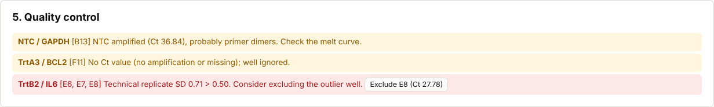
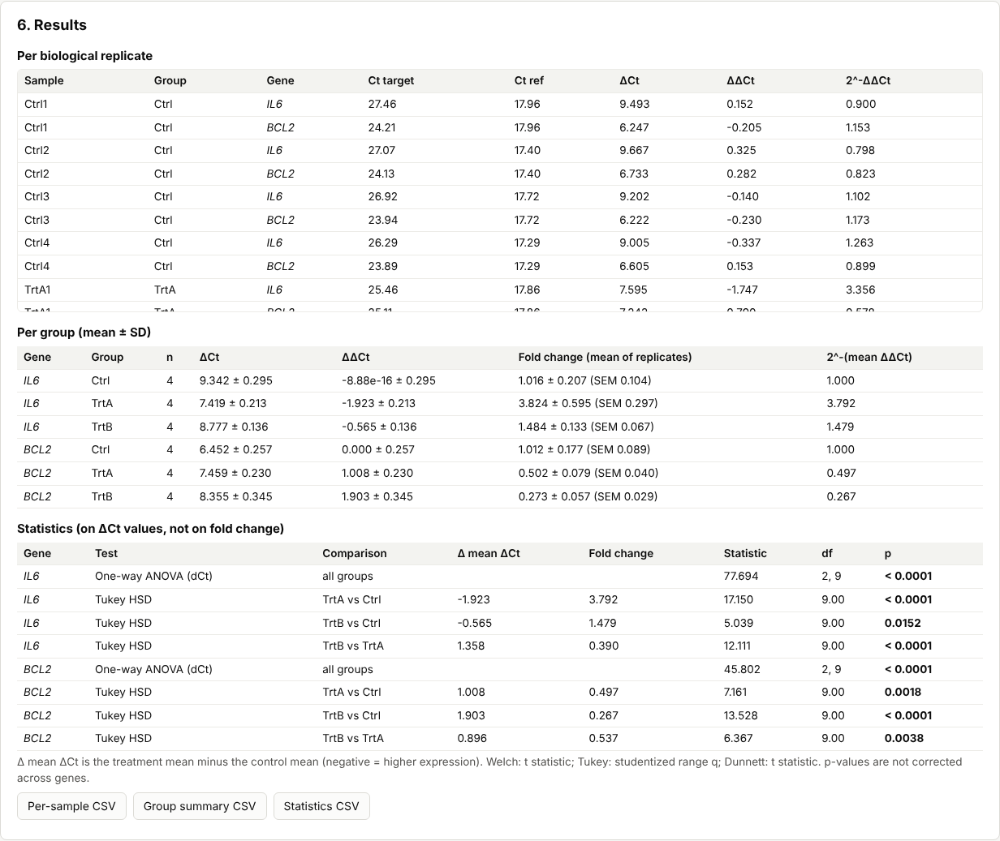
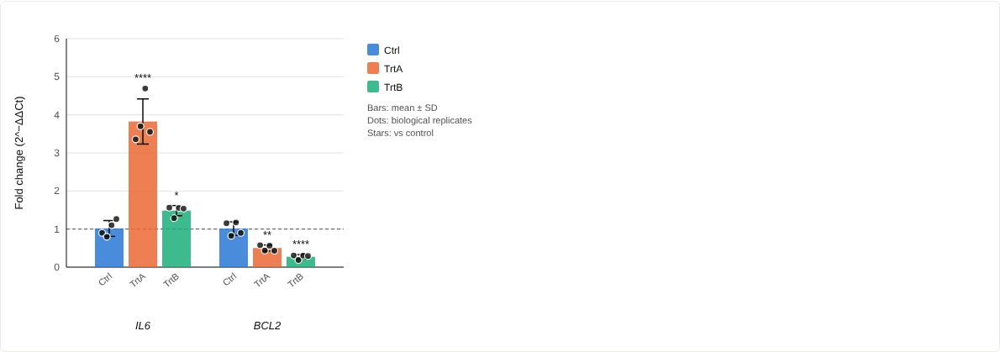
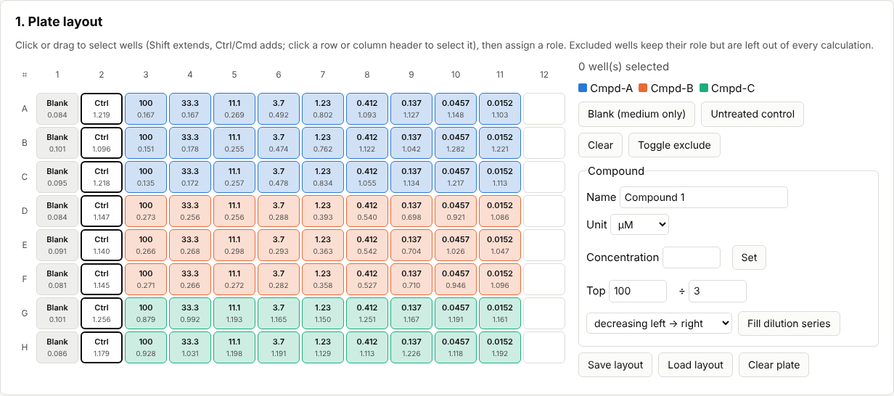
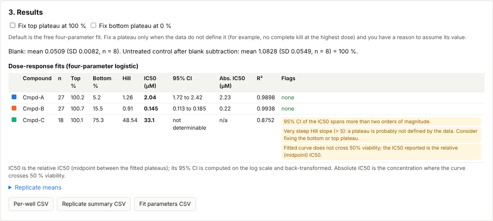
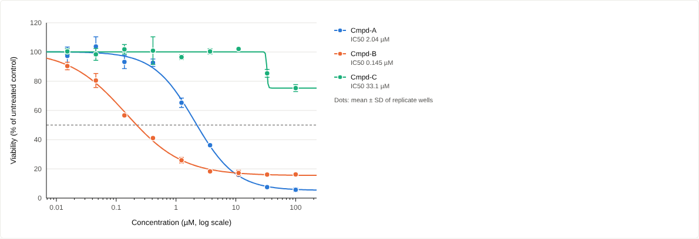

# labcalc

Browser-based calculators for two everyday wet-lab analyses:

- **qPCR relative expression** (ΔΔCt, Livak and Pfaffl) from Roche LightCycler 480 exports or any CSV/TSV table
- **Cell viability** (MTT, WST-1): % viability and four-parameter logistic IC50 fits from a 96-well plate

Nothing to install and nothing to upload: open the page, load your file, read the results.

**Live app:** `https://elmasnuryilmaz.github.io/labcalc/` (available once GitHub Pages is enabled for this repository, see [Deployment](#deployment)).

## Privacy: your data never leave your browser

labcalc is a static web page. Files are read by your browser and every calculation runs locally in JavaScript.
There is no server, no account, no analytics, no cookies, and no external fonts, scripts or libraries at runtime
(all code is bundled). The published page carries a Content-Security-Policy with `connect-src 'none'`, so the browser
itself blocks any network request the page could try to make. CSV, SVG and PNG downloads are generated in the browser.
The automated browser check in `scripts/screenshots.mjs` loads both calculators and fails if the page requests anything
outside its own origin.

## Screenshots

qPCR quality control, results and figure (synthetic example data):





Cell viability plate layout, fits and dose-response curves (synthetic example data):





The third compound in the viability example was simulated with its IC50 above the tested range. The free
four-parameter fit is not identifiable there, and the app says so; ticking "Fix bottom plateau at 0 %" gives a
defined fit that is flagged as an extrapolation.

## What it does

### qPCR (SYBR Green, relative quantification)

1. **Load** a LightCycler 480 text export (export the results table of an *Abs Quant / 2nd Derivative Max* analysis; the
   file has an optional `Experiment:` line, then tab-separated columns `Include, Color, Pos, Name, Cp, Concentration,
   Standard, Status`) or any CSV/TSV with a header row and a `Ct`, `Cp` or `Cq` column (optional `Well`, `Sample`,
   `Gene`/`Target`, `Group`). UTF-8 and UTF-16 files, decimal commas, `Undetermined` and empty Cp cells are handled.
   Wells with `Include = False` start excluded.
2. **Assign** wells to biological samples and genes: split the Name column (for example `Ctrl1_GAPDH`), assign genes or
   samples to well ranges (`A1-A12, B1:B6`), or edit cells directly.
3. **Groups and genes:** each sample gets a group (guessed from the name, editable); NTC wells are detected by name.
   Tick one or more reference genes (common ones such as *GAPDH*, *ACTB*, *RPLP0*, *HPRT1* are pre-ticked) and
   optionally enter primer efficiencies (%).
4. **QC flags:** technical-replicate SD above 0.3 (note) and 0.5 (flag, with a one-click exclusion of the outlying
   well), Ct above 35, undetermined or missing Ct, NTC amplification, samples missing reference or target values.
   Every threshold is adjustable and any well can be excluded.
5. **Results** per biological replicate (ΔCt, ΔΔCt, 2<sup>−ΔΔCt</sup>, Pfaffl ratio) and per group (n, mean, SD, SEM).
6. **Statistics on ΔCt** (not on fold change), per gene: Welch's t-test for two groups; one-way ANOVA followed by
   Tukey HSD (all pairs) or Dunnett (each group vs control) for more than two groups.
7. **Figure:** bar plot with individual biological replicates, SD or SEM, linear or log<sub>2</sub> scale, optional
   significance stars; download as SVG or 300 dpi PNG. Results download as CSV.

### Cell viability (MTT / WST-1)

1. **Plate layout editor** for a 96-well plate: drag to select wells, assign blank (medium only), untreated control, or
   compound and concentration; fill a serial dilution across columns or rows in one step; exclude wells; save and load
   layouts as JSON so a standard layout is set up once.
2. **Absorbance:** paste the 8 × 12 block from the plate reader or a spreadsheet; optionally paste a reference
   wavelength (for example 630 or 650 nm), subtracted well by well.
3. **Normalisation:** blank subtraction and % viability relative to the untreated control; replicate mean and SD.
4. **Dose-response:** four-parameter logistic fit per compound (Levenberg–Marquardt) with Top, Bottom, Hill slope,
   IC50 with 95% confidence interval, absolute IC50 (50 % crossing) and R². Top and/or Bottom can be fixed at 100 % / 0 %.
   Fits are flagged when the IC50 lies outside the tested range, the CI spans more than two orders of magnitude, the
   slope is implausibly steep, the curve never reaches 50 %, or there are no residual degrees of freedom.
5. **Figure:** log-concentration plot with means ± SD (or individual wells) and fitted curves for several compounds;
   SVG and PNG download; CSV exports per well, per replicate group and of the fit parameters.

## Methods

The **Methods** tab in the app gives every formula. In short:

- Technical replicates are averaged per sample and gene; with several reference genes their Ct values are averaged
  (equivalent to the geometric mean of their quantities).
- ΔCt = Ct<sub>target</sub> − Ct<sub>ref</sub>; ΔΔCt = ΔCt − mean ΔCt of the control group; fold change = 2<sup>−ΔΔCt</sup>
  (Livak & Schmittgen 2001).
- Pfaffl ratio = E<sub>target</sub><sup>ΔCt<sub>target</sub>(control − sample)</sup> / geometric mean over reference genes of
  E<sub>ref</sub><sup>ΔCt<sub>ref</sub>(control − sample)</sup>, with E = 1 + efficiency/100 (Pfaffl 2001). Statistics then use
  the efficiency-weighted ΔCt, which reduces to ΔCt when all E = 2.
- Welch t-test with Welch–Satterthwaite df; one-way ANOVA; Tukey HSD in the Tukey–Kramer form (studentized range
  distribution); Dunnett's many-to-one test (single step, two sided, multivariate t probability computed by numerical
  integration).
- % viability = 100 · (A − mean blank) / (mean untreated control − mean blank), after optional reference-wavelength
  subtraction.
- 4PL model y = Bottom + (Top − Bottom) / (1 + 10<sup>Hill·(log<sub>10</sub>x − log<sub>10</sub>IC50)</sup>), the same model as
  `LL.4` in the R package drc; least squares by Levenberg–Marquardt from several starting points; SE from
  s²(JᵀJ)<sup>−1</sup>; 95% CI of log<sub>10</sub>IC50 with the t distribution (n − p df), back-transformed.

### References

1. Livak KJ, Schmittgen TD (2001). Analysis of relative gene expression data using real-time quantitative PCR and the
   2<sup>−ΔΔCT</sup> method. *Methods* 25(4):402–408. doi:[10.1006/meth.2001.1262](https://doi.org/10.1006/meth.2001.1262)
2. Pfaffl MW (2001). A new mathematical model for relative quantification in real-time RT-PCR. *Nucleic Acids Research*
   29(9):e45. doi:[10.1093/nar/29.9.e45](https://doi.org/10.1093/nar/29.9.e45)

## Validation

Correctness is checked by unit tests (`npm test`) that compare every statistic and fit with reference values computed
independently in Python by `scripts/make_reference.py` (SciPy, NumPy) and stored in `tests/fixtures/reference.json`:

| What | Reference | Tolerance (relative) |
| --- | --- | --- |
| t and F p-values, t quantiles, studentized range CDF | `scipy.stats` | 1e-11 (studentized range 1e-7) |
| Welch t-test (t, df, p) | `scipy.stats.ttest_ind(equal_var=False)` | 1e-10 |
| One-way ANOVA (F, p) | `scipy.stats.f_oneway` | 1e-10 |
| Tukey HSD (difference, q, p) | `scipy.stats.tukey_hsd` | 1e-5 on p |
| Dunnett (t, p) | adaptive quadrature in SciPy; `scipy.stats.dunnett` | 1e-5; 5e-4 absolute (SciPy uses Monte Carlo integration) |
| ΔCt, ΔΔCt, fold change, Pfaffl ratio, group mean/SD/SEM, all tests on both example datasets | independent NumPy implementation + SciPy tests | 1e-10 |
| % viability, blank and control means | NumPy | 1e-10 |
| 4PL parameters, standard errors, IC50 95% CI, R², absolute IC50 (free and constrained fits) | `scipy.optimize.curve_fit` (Levenberg–Marquardt) | 1e-5 parameters, 1e-4 SE and CI |

To regenerate the fixtures and the synthetic examples (requires Python 3 with NumPy and SciPy):

```bash
python3 scripts/make_reference.py
```

## Example data (synthetic)

All example files are **simulated** with a fixed random seed by `scripts/make_reference.py`; they are not measurements.

- `examples/qpcr_lc480_synthetic.txt`: LightCycler 480-style export, 384-well plate, 3 groups × 4 biological replicates,
  reference genes *GAPDH* and *ACTB*, targets *IL6* and *BCL2*, technical triplicates, with an outlier replicate, a failed
  well and an amplifying NTC for the QC demo.
- `examples/qpcr_two_groups_synthetic.csv`: tidy CSV, 2 groups × 4 replicates, two reference genes, one target.
- `examples/viability_570nm_synthetic.tsv`, `examples/viability_650nm_reference_synthetic.tsv`,
  `examples/viability_layout_synthetic.json`: one 96-well MTT plate with three compounds in a 1:3 dilution series.

The app loads them with the "Load synthetic example" buttons.

## Run it locally

Requires Node.js 22 (or 20.19 and newer).

```bash
npm ci
```

```bash
npm run dev
```

Open the address Vite prints (usually http://localhost:5173). Other commands:

```bash
npm test
```

```bash
npm run build
```

`npm run build` writes the static site to `dist/`. To use it offline, serve that folder with any local static server
(browsers do not run module scripts from `file://` URLs), for example:

```bash
python3 -m http.server --directory dist 8000
```

To refresh the README screenshots and re-run the in-browser privacy check (needs Playwright with Chromium):

```bash
npm run build && npx vite preview --port 4173
```

```bash
node scripts/screenshots.mjs
```

## Deployment

`.github/workflows/ci.yml` runs the tests and the production build on every push and pull request.
`.github/workflows/pages.yml` builds the site and publishes it to GitHub Pages on every push to `main`. To turn it on,
go to *Settings → Pages* and choose *GitHub Actions* as the source. GitHub Pages for a **private** repository requires a
paid GitHub plan; on a free plan the repository has to be public for the site to go live.

## Limitations

- One 96-well plate per viability analysis; one qPCR run (plate) per analysis.
- SYBR Green relative quantification only (no standard curves, no absolute quantification, no melt-curve analysis).
- p-values are not adjusted across genes. ANOVA, Tukey and Dunnett assume similar variances across groups.
- No automatic outlier removal: flagged wells are excluded only when you decide to.

## Tech

TypeScript, Vite, no UI framework. Distribution functions partly from [jStat](https://github.com/jstat/jstat)
(studentized range, normal CDF, starting value for the t quantile); the incomplete beta function, Dunnett integral and
Levenberg–Marquardt fit are implemented in `src/lib`. Tests use Vitest.
